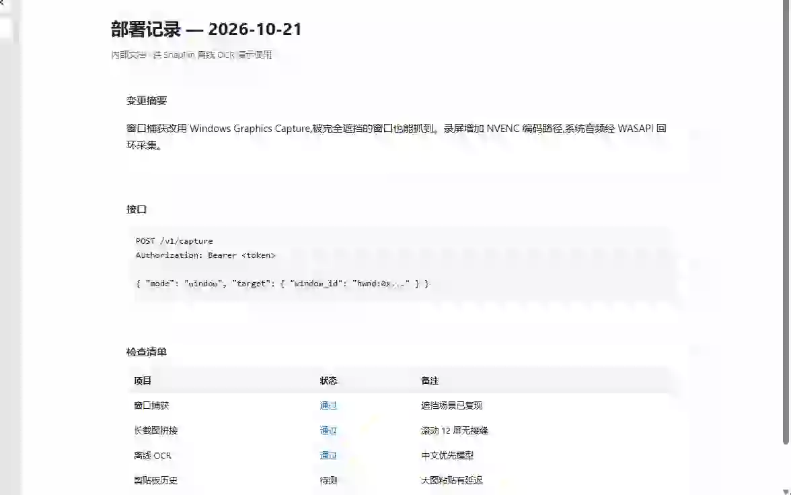
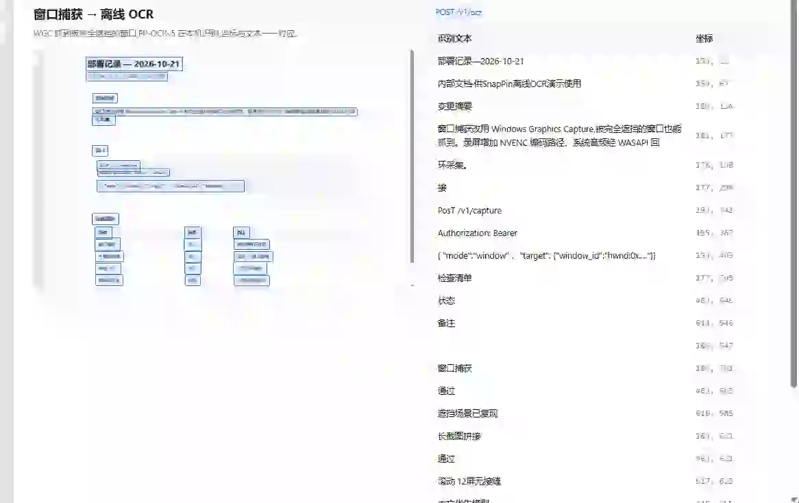

# SnapPin

A Windows screen-capture, recording and clipboard toolkit with a local HTTP API, so a script — or an AI coding agent — can drive it.

Rust core (Windows APIs) + Tauri 2 shell + React overlay UI. No cloud, no account, no telemetry.


| Window capture | Fully local OCR |
|---|---|
|  |  |
| Windows Graphics Capture pulls a window even when other windows cover it. | The same capture fed to the bundled PP-OCRv5 engine — every line comes back with its coordinates, and no pixel leaves the machine. |

---

Hit one hotkey and a frozen screen appears under your cursor. Pick a window — even one buried under six other windows — drag a box, take the pen, and the PNG is already on your clipboard. The same app records your screen with the system audio, stitches a long page into one image, and reads the text off it without sending a pixel anywhere.

## What it does

| Area | Capability |
|---|---|
| **Capture** | Region, full screen, or a **single window** — window capture uses Windows Graphics Capture, so it grabs a window that is *fully covered* by other windows |
| **Long screenshot** | Scroll-and-stitch capture for tall pages |
| **Annotate** | Rectangle, ellipse, arrow, pencil, text, numbered steps; undo/redo; two-level colour palette; the toolbar never gets captured into the frame |
| **Pin** | Keep an image floating above everything else |
| **Record** | Region and window recording, GPU-encoded (NVENC through ffmpeg), system audio captured via WASAPI loopback, MP4 or GIF output, pause/resume |
| **Clipboard history** | A `Win+V`-style panel for text and image entries, with search |
| **OCR** | Fully local PP-OCRv5 (`oar-ocr`) — Chinese-first, no round-trip to a cloud API |
| **Automation** | A local HTTP API on `127.0.0.1` with a bearer token, so screenshots, recordings and OCR can be scripted |
| **Shell** | Tray-resident, single instance, rebindable global hotkeys, a settings window that stays in one pane |

Default hotkeys (all rebindable in Settings): `Ctrl+1` capture, `Ctrl+2` pin, `Ctrl+Shift+R` record, `Ctrl+Shift+V` clipboard history.

## Platform

Windows 10/11, x86-64. The capture, recording, UIA and clipboard paths are all Win32-specific, so there is no other supported platform yet.

## Releases

Prebuilt Windows binaries are published on the [Releases page](https://github.com/umhapal/snappin/releases).

| Asset | What it is |
|---|---|
| `snappin-v0.1.0-windows-x64.exe` | Portable build — no installer, runs from any folder |
| `snappin-ocr-engine-v0.1.0.zip` | The OCR engine (ONNX Runtime + PP-OCRv5 models) |

To enable OCR, unzip the engine archive so that `onnxruntime.dll` and the `.onnx` models end up in `engines/oar-ocr/` **next to the executable**. If the executable lives in a read-only location (e.g. `Program Files`), put the same folder in `%LOCALAPPDATA%\snappin\engines\oar-ocr\` instead, or point `SNAPPIN_OCR_ENGINE_DIR` at it.

Recording needs `ffmpeg` on `PATH` (or `SNAPPIN_FFMPEG` pointing at it). Everything else works out of the box.

## Build from source

Prerequisites:

- Rust (stable; MSVC or the `x86_64-pc-windows-gnu` toolchain both work)
- Node.js 20+ (or Bun)
- WebView2 runtime — preinstalled on Windows 11
- `ffmpeg` on `PATH` — only needed for recording
- The ONNX Runtime DLL — only needed for OCR; the engine can fetch it on first use

```bash
npm install
npm run tauri dev      # run it
npm run tauri build    # produce a Windows installer / portable exe
```

## HTTP API

The app serves a small REST API on `127.0.0.1:47821` (the port is configurable). Every endpoint except `/v1/health` requires the token from `config.json`:

```
Authorization: Bearer <token>
```

| Method | Path | Purpose |
|---|---|---|
| `GET` | `/v1/health` | Liveness (no auth) |
| `POST` | `/v1/capture` | Capture: `mode` = `region` \| `fullscreen` \| `window` (window mode takes a nested `target.window_id`) |
| `POST` | `/v1/longshot` | Scroll-and-stitch capture |
| `POST` | `/v1/record/start` | Start a region or window recording |
| `POST` | `/v1/record/stop` | Stop the recording (optionally transcode to GIF) |
| `POST` | `/v1/record/pause` / `/v1/record/resume` | Pause and resume |
| `GET` | `/v1/record/status` | Recording state and progress |
| `GET`/`POST` | `/v1/windows` | Snapshot of visible windows (title, rect, capture capabilities) |
| `POST` | `/v1/uia` | UI Automation element lookup at a point — used by smart window detection |
| `GET`/`PUT`/`POST` | `/v1/settings` | Read and update the app configuration |
| `POST` | `/v1/ocr` | Run local OCR on an image or a screen region |
| `POST` | `/v1/pin` | Pin an image to the desktop |

Example:

```bash
TOKEN=$(python -c "import json;print(json.load(open(r'%APPDATA%\com.snappin.app\config.json'))['token'])")
curl -H "Authorization: Bearer $TOKEN" -X POST http://127.0.0.1:47821/v1/capture \
  -H "Content-Type: application/json" -d '{"mode":"fullscreen"}'
```

POST requests accept an `Idempotency-Key` header: repeating the same `(method, path, key)` within the TTL replays the first response instead of performing the side effect twice.

## Layout

```
src/            React overlay, settings, clipboard and pin UI
src-tauri/src/  Rust core
  capture.rs      GDI region/fullscreen capture
  window_recorder.rs  Windows Graphics Capture (single window, occlusion-immune)
  recorder.rs     ffmpeg pipeline, GPU encode, audio devices
  longshot.rs     scroll stitching
  ocr.rs          local PP-OCRv5 pipeline
  clip.rs         clipboard history
  uia.rs          UI Automation element lookup
  http.rs         the local REST API
  window.rs       window enumeration
```

## Configuration

Settings live in `%APPDATA%\com.snappin.app\config.json` (hotkeys, save directory, capture format, recorder bitrate, OCR behaviour, and so on). The UI writes it through `/v1/settings`.

Two environment variables override the on-disk defaults:

- `SNAPPIN_FFMPEG` — explicit path to the `ffmpeg` binary
- `SNAPPIN_OCR_ENGINE_DIR` — directory holding `onnxruntime.dll` and the OCR models

## Contributing

See [CONTRIBUTING.md](CONTRIBUTING.md).

## Third-party components

| Component | License | Used for |
|---|---|---|
| [ONNX Runtime](https://github.com/microsoft/onnxruntime) | MIT | OCR inference runtime |
| [PP-OCRv5](https://github.com/PaddlePaddle/PaddleOCR) (via `oar-ocr`) | Apache-2.0 | Chinese and Latin text detection and recognition |
| [FFmpeg](https://ffmpeg.org) | LGPL/GPL, depending on the build | Screen recording, GIF transcoding |
| [Tauri](https://tauri.app) 2, [React](https://react.dev) | MIT / Apache-2.0 | App shell and overlay UI |
| `tiny_http`, `arboard`, `windows-rs`, `image` | MIT / Apache-2.0 | HTTP server, clipboard, Win32 bindings, image encoding |

## License

MIT — see [LICENSE](LICENSE).
